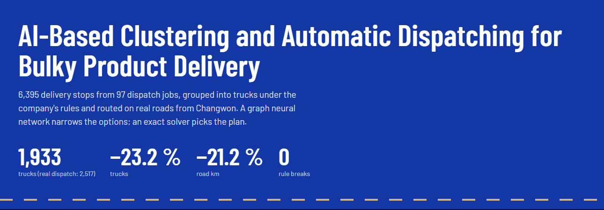
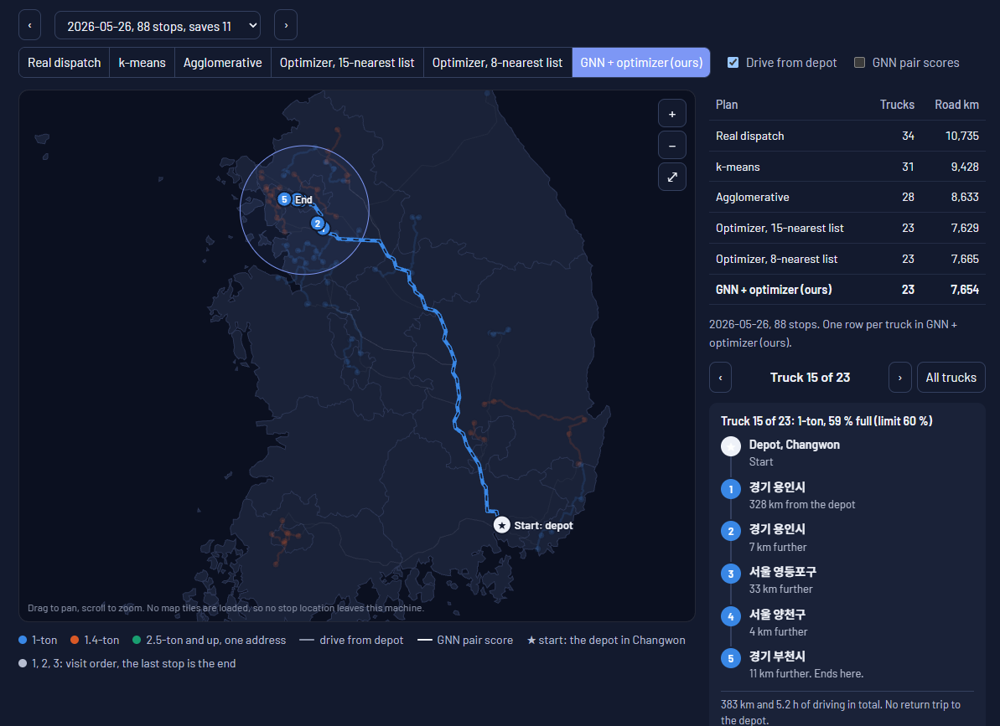

# AI-Based Clustering and Dispatching Prototype — Version 1

This repository presents **Version 1 of an AI-assisted dispatch planning prototype for bulky-product delivery**.

The prototype demonstrates how delivery stops can be grouped and optimized while considering practical operational constraints such as the number of stops per truck, loading capacity, and spatial coverage.

> **Note:** The original company logistics dataset is not included in this repository. The public demo uses synthetic data only.

## Prototype Workflow

The planning process follows four main steps:

**Delivery Orders → Candidate Grouping → Optimization → Dispatch Plan**

The prototype combines:

- AI-assisted delivery-stop grouping
- Constraint-aware truck assignment
- Mathematical optimization
- Route sequencing
- Dispatch-plan visualization

## Demo

A reproducible demonstration using **synthetic delivery data** is included.

The demo contains:

- 26 synthetic delivery stops
- Delivery volume for each stop
- Spatial coordinates
- Operational clustering constraints

The planner generates feasible truck groups and determines the visiting order for each truck.

Run the demo with:

```bash
python -I competition/demo.py
```

No company data or external API is required.

## Example Output

The planner produces a dispatch plan similar to:

```text
Truck 1
S03 → S05 → S01 → S08 → S04

Truck type: 1.4-ton
Load volume: 4.55 m³
Load utilization: 96%
Route distance: 87 km
```

Each output contains:

- Assigned delivery stops
- Visiting sequence
- Truck type
- Load utilization
- Estimated route distance

## Prototype

An interactive web prototype is available here:

**Live Prototype:**  
https://delivery-plan.lalithsai00.workers.dev/ 

The prototype demonstrates the planned dispatcher workflow and visualization interface.

### Prototype Screenshots





## Repository Structure

```text
.
├── competition/
│   ├── demo.py
│   └── synthetic_job.json
│
├── cluster/
│   ├── exact.py
│   └── ryry.py
│
├── images/
│   ├── prototype-v1.1.png
│   └── prototype-v1.2.png
│
├── requirements.txt
├── .gitignore
└── README.md
```

## Installation

Clone the repository:

```bash
git clone https://github.com/ryryrizki/bulky-delivery-planner-v1.git
cd bulky-delivery-planner-v1
```

Create a virtual environment:

```bash
python3 -m venv .venv
source .venv/bin/activate
```

Install the dependencies:

```bash
pip install -r requirements.txt
```

Run the demo:

```bash
python -I competition/demo.py
```

## Data Privacy

The original project was developed using real-world logistics data.

However, the original company dataset contains operational and location-related information and is **not distributed through this public repository**.

Only synthetic demonstration data is provided here.

## Current Version

**Prototype Version 1**

The current version focuses on demonstrating the core dispatch-planning workflow.

Future versions may extend the system with additional operational constraints, alternative AI models, physical truck-loading optimization, and integrated routing and vehicle-assignment capabilities.